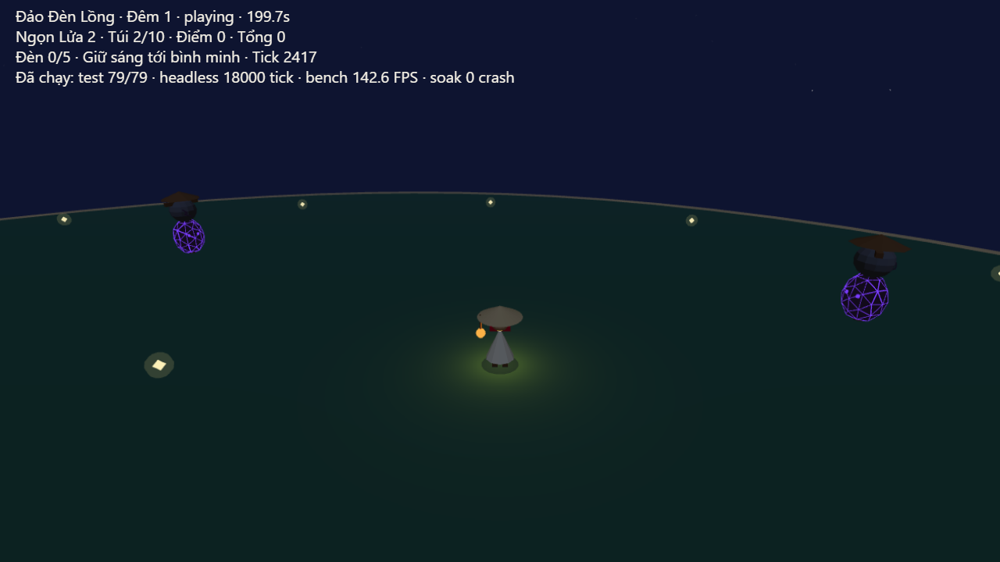

# Đảo Đèn Lồng — v1.0.0 / Phase 4

[Xem/tải video demo MP4 dưới 5 phút](https://github.com/thailc0903/K5-L3A-DAY12-HaHuyThai-2A202603682-AI-SDLC-Dao-Den-Long/releases/download/v1.0.0/demo.mp4) · [Bản phát hành](https://github.com/thailc0903/K5-L3A-DAY12-HaHuyThai-2A202603682-AI-SDLC-Dao-Den-Long/releases/tag/v1.0.0)



Game 3D góc nhìn thứ ba qua ba Đêm: Đảo Bến, Đảo Cầu Tre, Đảo Tháp Chuông. Điều khiển Mây gom đom đóm, thắp/châm dầu và **giữ đảo sáng tới bình minh**. Triển khai PRD-0 + Ticket-02/03/04, Test Contract **v1.3**.

README gốc và các tài liệu lab được giữ nguyên theo lựa chọn người học. Đây là hướng dẫn sản phẩm; mọi lệnh dưới đây chạy từ **gốc repo**.

## Cài và chạy trong 3 lệnh

Điều kiện: Node.js20+ trong PATH, Git để clone, trình duyệt hỗ trợ WebGL2 và màn hình1280×720 trở lên. Benchmark dùng Chrome/Edge/Chromium; có thể chọn executable bằng BENCH_BROWSER. Không cần npm install, tài khoản hoặc Internet sau clone vì Three.js đã đi kèm. Đã kiểm tra trên Windows11/Node24; CI dùng Linux/Node20. Chưa thử macOS, chưa xác lập CPU/GPU/RAM tối thiểu. Cấu hình máy tham khảo ở [machine.json](../proof/phase-4/machine.json), không phải cấu hình máy chấm.

```sh
git clone https://github.com/thailc0903/K5-L3A-DAY12-HaHuyThai-2A202603682-AI-SDLC-Dao-Den-Long.git dao-den-long
cd dao-den-long
node scripts/serve.mjs
```

Mở http://127.0.0.1:4173 và chọn Bắt đầu hành trình. Nếu đã chạy server bản cũ, dừng bằng Ctrl+C rồi chạy lại lệnh server, tải lại trang. Đổi PORT nếu cổng bận.

Hoặc tải ZIP trong Release, giải nén và chạy `node scripts/serve.mjs` trong thư mục dao-den-long; START-HERE.txt có chỉ dẫn. Node không nằm trong ZIP, cần cài sẵn. Kiểm tra SHA256SUMS.txt nếu muốn xác nhận file tải.

Máy Windows hiện tại có thể dùng `./play.ps1` trong PowerShell: script tìm Node trên PATH hoặc runtime Codex sẵn có, không cài đặt hoặc đổi cấu hình máy.

## Chơi ba Đêm

Menu → giới thiệu Đêm và lời Ông Đăng → chơi → kết quả → Đêm tiếp. Thua được chơi lại chính Đêm đó; thắng Đêm3 hiện Bình Minh với tổng điểm các Đêm đã thắng.

| Thao tác | Hành động |
|---|---|
| WASD / mũi tên | Di chuyển theo hướng camera |
| Space | Nhảy khi chạm đất |
| Shift | Lướt; đang đứng yên thì theo hướng mặt |
| Kéo chuột | Quay camera |
| E | Nạp/thắp lại/châm dầu đèn nhận được gần nhất trong 2 m, hòa chọn id nhỏ |
| Q | Tỏa Sáng, tiêu 3 đom đóm, hồi 3 s |
| Esc / P | Tạm dừng; Tiếp tục / Chơi lại Đêm / Cài đặt / Về menu |

Nhặt tự động trong 1 m và chênh cao ≤1,5 m. Túi ban đầu10, tăng2 sau mỗi lần thắp/thắp lại thành công, tối đa20; đặt lại đầu Đêm. Đèn chưa từng sáng cần10, thắp lại chỉ5 và nhớ tiến độ nạp. Mỗi lần thắp có100 dầu; hao1/giây. E tại đèn sáng dùng mỗi đom đóm thêm10 dầu, tối đa100. Đèn đầy không nhận; đèn cạn tắt và mất tiến độ nạp.

Đèn còn ≥30 dầu bảo vệ trong6 m. Dưới30 đèn/thanh dầu nhấp nháy1Hz, mất vùng an toàn; Bóng Mực đang wander tìm đèn yếu và hút thêm5 dầu/giây/con trong2 m. Q ngắt hút/choáng/đẩy; châm dầu đủ30 cũng đẩy con bên trong ra. Bóng Mực gây mất1 Ngọn Lửa và rơi nửa số đom đóm; bạn có90 tick bất tử. Rơi xuống dưới Y=−10 mất1 Ngọn Lửa và toàn bộ đom đóm, chờ1 s rồi hồi sinh nếu còn sống.

Đêm2 có cầu không lan can và bục nhảy phóng sang đảo kia. Gió Lạc cướp đom đóm; pulse khi nó đang flee để đòi lại. Bùa đỏ tăng chạy lên7,2 m/s, bỏ hồi dash trong10 s. Đêm3 cần dùng dốc/bục để lên tầng; lá và âm thanh báo gió mạnh trước2 s.

Thắp đủ không kết thúc sớm. Sống tới bình minh với ít nhất **3/5, 4/6, 5/7** đèn đang sáng tương ứng Đêm1/2/3 để thắng. Hết Ngọn Lửa luôn thua trước, kể cả tick cuối; tới bình minh thiếu đèn cũng thua. Thời gian: **240/270/300 s**. Quyết định/biên tick ở [ADR-003](../notes/phase-3-adr.md); luật Phase2 không bị thay vẫn giữ.

## Điểm chuẩn

- Nhặt không cộng điểm; mỗi đom đóm **nạp hoặc châm dầu** +5.
- Thắp lần đầu +100; thắp lại +40.
- Mỗi Bóng Mực trúng Tỏa Sáng tổng +15 nếu đang hút dầu ngay trước pulse, các trạng thái khác +5.
- Bình minh chỉ khi thắng: mỗi đèn đang sáng +`50+floor(fuel)`; mỗi Ngọn Lửa còn lại +50. Bỏ thưởng thời gian.
- Tổng hành trình chỉ cộng điểm Đêm đã thắng; retry không cộng lặp.

Ví dụ thắp lại ngay tick bình minh cần5: +25+40. Nếu cuối tick có3 đèn với dầu99,98/99,98/100 và3 Ngọn Lửa: thưởng149+149+150+150, tổng điểm mới663. Đèn đặt lit sẵn trong scenario không tự cộng điểm hoặc đếm successful_lights.

## Cài đặt, âm thanh và sáng tạo

Cài đặt ở menu hoặc pause có âm lượng, độ nhạy chuột và **Bảng màu dễ phân biệt**; lưu localStorage trên trình duyệt. Chế độ dễ phân biệt đổi mắt/viền Bóng Mực sang xanh #00B3FF, cảnh báo UI trắng kèm⚠. Đèn tắt xẹp20% và giấy rách; đèn yếu nhấp nháy, không cần màu để phân biệt. Âm thanh procedural gốc gồm nhạc đêm và SFX theo hành động; được mở sau thao tác bắt đầu chơi.

**Đổi phím:** chọn một trong9 hành động trong Cài đặt, bấm phím mới; trùng phím báo lỗi, không ghi đè. Có Khôi phục mặc định, HUD theo phím mới. Arrow/P/Shift phải vẫn là alias mặc định khi chưa được gán sang hành động khác. Giảm chuyển động tắt các hiệu ứng pulse/hạt/bobbing và CSS nhấp nháy; không có rung camera/chớp toàn màn. Chữ tối thiểu18px tại1280×720, tùy chọn Chữ lớn×1.25. Bóng Mực xuất hiện có mũi tên/chữ5s ở mép màn, gió báo trước2s,10s cuối và đèn ít dầu có chữ cảnh báo.

## Bảng xếp hạng trên đĩa

Sau thua bất kỳ Đêm hoặc Bình Minh (thắng Đêm3), nhập tên3–12 ký tự A–Z/a–z/0–9/_. Lưu tổng điểm các Đêm đã thắng, nights_won, ngày ISO UTC và seed. Menu có Bảng xếp hạng top10; hòa điểm xếp người đạt trước. File `.local/leaderboard.json` còn sau khi đóng game/server và không được commit vào repo. Xóa file này sẽ xóa điểm cục bộ; có thể chọn đường dẫn bằng LEADERBOARD_PATH.

```sh
node scripts/serve.mjs --export-leaderboard out.json
```

Lệnh xuất rồi thoát; không cần server đang chạy. Bản ZIP vẫn cần Node server để lưu điểm, không mở index.html trực tiếp bằng file://.

### Sáng tạo của tôi

**Dải sao dẫn bình minh**: đèn thắp thêm sao và đường nối trên bầu trời, hạt vàng quanh đèn, âm sắc riêng theo tiến độ. Tắt bằng tùy chọn trong Cài đặt hoặc mở http://127.0.0.1:4173/?creative=0. Phần này chỉ ở view/audio, không thêm thực thể, điểm, event hoặc RNG gameplay. Headless không import chúng.

CPU scene tests xác nhận có thể bật/tắt và dựng ba map; kiểm chứng logic/headless vẫn tất định. Benchmark và soak chuẩn tắt sáng tạo; ảnh benchmark và video gameplay thật có trong bằng chứng Phase4.

## Kiểm chứng và headless

Kiểm tra build/cú pháp: `node scripts/check.mjs`.

Chạy gate đầy đủ và sinh lại bằng chứng thật:

```sh
node scripts/verify.mjs
```

Headless không cần GPU/cửa sổ, nhận night1/2/3:

```sh
node scripts/headless.mjs --seed 12 --night 2 --ticks 1200 --out test-output/night2.jsonl
```

Ví dụ Bóng Mực hút dầu:

```sh
node scripts/headless.mjs --seed 12 --night 1 --ticks 120 --scenario tests/scenarios/phase-3/drain.json --snapshot-every 1 --out test-output/drain.jsonl
```

Snapshot tick0 trước input, có event night_start tại0; bước k dùng input k tạo trạng thái k+1. Khi paused, tick tăng và sim_tick đứng yên. Dòng cuối luôn là end. JSON/shape đầu vào sai trả exit2, thông báo stderr; chạy hợp lệ exit0; lỗi chạy khác nonzero.

Manifest `tests/scenarios/phase-3/cases.json` có9 scenario dầu; verify cũng chạy lại9 scenario Phase2 còn hiệu lực. Gate chạy79 test, fixture thắng từng Đêm, hai lần18.000 bước, so byte24JSONL với Phase3, soak và kiểm tra video/hash benchmark đã lưu. Bằng chứng ở [docs/proof/phase-4](../proof/phase-4/README.md). Gate CI kiểm tra số đo đã commit; không tự nhận CI có GPU hay chạy lại benchmark cửa sổ.

## Benchmark chuẩn và soak

```sh
node scripts/bench.mjs --seed 42 --duration 30 --out bench.json
node --jitless --expose-gc --max-semi-space-size=1 scripts/soak.mjs --seed 7 --nights 10 --out soak.json
```

Benchmark tự mở cửa sổ app1280×720, Đêm1 với200 Bóng Mực wander,100 đom đóm, L1–L3 sáng/fuel100. Player đứng gốc, camera vòng15s, tắt sinh/hit/nhặt/hao dầu/end; sáng tạo tắt. Giữ cửa sổ hiện: warmup3s rồi đo30s, tự đóng/exit0. Không có API WebGL chuẩn để tắt vsync, vì vậy `vsync_off:false`; RSS renderer web không đọc tin cậy nên `peak_mem_mb:null`, không thay bằng JS heap. Có bench-context.json/hash và bench-scene.png cùng thư mục output. Chỉ số avg/1%low/p95/load đúng định nghĩa ở [thiết kế Phase4](../notes/phase-4-release.md).

Soak chạy10Đêm liên tiếp cùng tiến trình, vòng1→2→3, seed7+i (i từ0); input ngẫu nhiên đúng xác suất ticket, reset cuối rồi lấy RSS. Cờ Node công khai giảm chi phí JIT/young heap và chạy GC ở hai ranh giới RSS; không pad baseline. Test này đo Node headless, không đo rò bộ nhớ WebGL. Ngưỡng:0crash và RSS cuối≤120%đầu. Số đo thật trong bench.json/soak.json ở bằng chứng; máy chấm cần đo lại trên cấu hình giảng viên.

## Đo FPS khi chơi và ghi demo

1. Nhấn Đo FPS720p ở góc dưới trái (hoặc mở `?benchmark=1`). Drawing buffer chuyển đúng1280×720, pixel ratio1.
2. Chơi ở tab đang hiện: warmup3 s, sau đó đủ30 s đo. Pause/ẩn tab không tính vào số đo.
3. Nhấn Lưu kết quả FPS. Đây là bộ đo khi chơi giữ từPhase2 (ngưỡng30FPS), **không thay thế benchmark chuẩn200 Bóng Mực** ở trên.

Ghi video bằng “Ghi demo game” → chơi → “Dừng và lưu”, tối đa4phút; Chrome hiện tại xuất MP4/H.264, browser không hỗ trợ sẽ xuất WebM để chuyển định dạng trước nộp. Chỉ canvas + HUD/số đo đã sinh được ghi, không desktop/âm thanh. `node scripts/demo.mjs` mở cửa sổ riêng và tự lưu video/ảnh vào docs khi người học bấm nút; lệnh này cần giao diện desktop. Video nộp đã được người học quay trực tiếp, có cấu trúc/thời lượng MP4 kiểm tra bằng `node scripts/video-check.mjs`.

Đã có benchmark GPU và gameplay thật; chưa xác nhận toàn bộ menu/settings/camera/âm thanh trên mọi máy. Tests scene dùng backend CPU không vẽ, không thay cho review bằng mắt/nghe độc lập.

## Harness và bàn giao

[AGENTS.md](../../AGENTS.md), script verify và workflow dùng Contract1.3. Hook bật sau khi Node có PATH bằng `git config core.hooksPath .githooks`; CI Ubuntu chỉ coi là đạt khi có run thật xanh. Phase4 chỉ cập nhật assertion version và thêm test, không skip các test cũ. Game/tuning v1.2 và output headless giữ nguyên. [Changelog](../../CHANGELOG.md), [thiết kế/giới hạn](../notes/phase-4-release.md), [retro bốn phase/token](../notes/RETRO.md).

Giữ tag phase-1/phase-2/phase-3; bàn giao bằng phase-4 và Releasev1.0.0. Có ZIP chạy offline sau khi tải và cài Node, video MP4, bench/soak. Hạn tag theo Coach, chưa có mốc giờ để xác nhận đúng hạn. Người học cần review độc lập và kiểm tra checklist UI trong bằng chứng. README lab ở gốc được giữ nguyên theo lựa chọn đã xác nhận ở Phase4.

Giấy phép và nguồn: [CREDITS.md](../../CREDITS.md), [LICENSE](../../LICENSE), vendor/THREE-LICENSE.txt. Không có API key hoặc dịch vụ tài khoản trong game.
